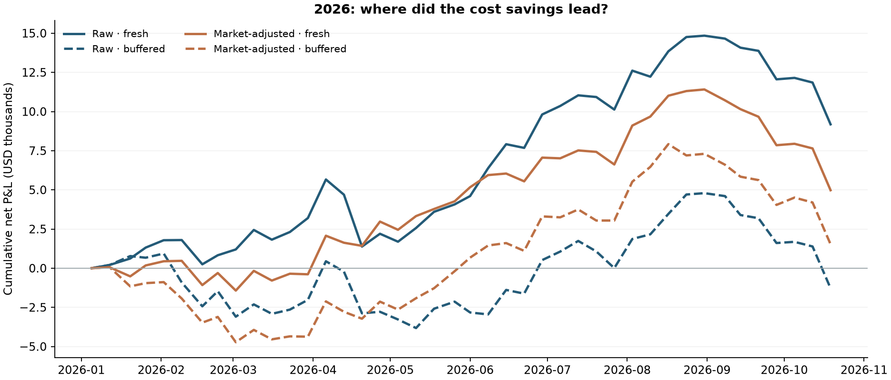

# Sector Signals and Turnover: full study

[Back to the project](../README.md). File paths and commands below are relative to the repository root.

**When does trading less help a short-term signal?**

A small Python study of eleven US sector ETFs. It separates two questions: does a recent decline predict a rebound, and should every change in the ranking trigger a change in holdings? Two fixed signals are crossed with two portfolio rules. The study complements projects on market-making inventory and stock-order execution by examining whether to generate a trade in the first place.

## What happened

The first experiment compared raw sector reversal with market-adjusted reversal. Both lost money after assumed costs in 2022–2025. The extension then tested a fixed rank buffer to reduce turnover, with the original signals and accounting unchanged.

| Net P&L at 5 bp one-way cost | 2019–2021 | 2022–2025 | Jan–Oct 2026 |
|---|---:|---:|---:|
| Raw signal, fresh selection | −$3,807 | −$9,125 | +$9,183 |
| Raw signal, rank buffer | +$7,583 | −$7,423 | −$1,282 |
| Market-adjusted signal, fresh selection | +$4,335 | −$16,596 | +$4,977 |
| Market-adjusted signal, rank buffer | +$4,502 | −$12,473 | +$1,527 |
| Complete weekly intervals | 155 | 208 | 41 |

Each rule targets **$100,000 gross notional: $50,000 long and $50,000 short**, reset weekly. This is exposure, not a verified investment or margin balance. Dollar P&L is added, not compounded. Net includes trading costs and assumed 1% annual short borrow.

**The buffer saved costs in every period, but did not improve net P&L in every period.** In 2026, raw-signal turnover fell 27.3%. The buffer saved $842 in trading costs but reduced gross P&L by $11,307, leaving net P&L $10,465 worse. For the market-adjusted signal, net P&L fell by $3,451. This is evidence against assuming that a reasonable turnover rule transfers unchanged to a different period.

The two mean weekly rank ICs in 2026 were +0.101 and +0.092; both descriptive 95% intervals include zero. Positive P&L in this short period does not establish a persistent forecasting edge. All four configurations are reported; no best-performing variant or threshold was selected after seeing these results.



## The four-way comparison

**Signals.** At the final close of each week, rank five-session log returns across XLB, XLC, XLE, XLF, XLI, XLK, XLP, XLRE, XLU, XLV and XLY. The raw signal uses the return itself. The adjusted signal subtracts each ETF's estimated beta times the same-period SPY return. Beta uses 126 daily returns ending before the signal window. OLS includes an intercept; only the slope is used to adjust the signal. SPY is not traded.

**Fresh selection.** Buy the three lowest scores and short the three highest, each at one-sixth of gross notional. Entry is at the following session's adjusted-open reference; exit/rebalance is at the next weekly entry.

**Rank buffer.** Rank 1 is weakest and rank 11 strongest. Keep an existing long while its rank is 1–5, and an existing short while its rank is 7–11. Fill vacancies from the most extreme available ranks, preserving three distinct holdings on each side. Ties use alphabetical order. Every reporting period starts flat; annual summaries within a period do not reset holdings.

For example, a long moving from rank 3 to rank 4 is retained; at rank 6 it is replaced. The two-rank buffer was fixed before its first run. It changes membership, not the forecasting score, so it cannot claim a better signal IC. Even unchanged members are rebalanced to equal dollar weights: price-drift trades still incur cost.

## Diagnostics that explain the result

- **Rank IC:** Spearman correlation between negative signal scores and subsequent open-to-open returns. One weekly cross-section is one observation; eleven related sectors are not eleven independent weeks. Average ranks handle ties.
- **Cost attribution:** buffer minus fresh net P&L equals the gross P&L difference plus trading-cost savings plus borrow-cost savings. Borrow is identical here because initial short exposure and dates are identical.
- **Cost crossover:** the one-way fee at which the two policies have equal historical net P&L. For raw reversal this was 2.83 bp in 2022–2025 but 67.12 bp in 2026. These are accounting diagnostics, not estimated attainable fees or chosen parameters. The latter is outside the 0–10 bp comparison range.
- **Uncertainty:** paired four-week moving-block bootstrap, 5,000 draws, fixed seed. It preserves short blocks of weekly observations, but does not resolve uncertainty about future market conditions. Risk, turnover, changed holding names and year-by-year results remain in the saved outputs.

The 2026 raw buffer-minus-fresh mean weekly difference was −$255, with a descriptive 95% interval of [−$456, −$97]. The adjusted-signal interval includes zero. These are conditional comparisons, not proof that buffering is universally harmful.

## Explain the difference one ETF at a time

The report now includes a weekly attribution explorer. Select either signal and any complete 2026 holding week to see all eleven ETFs: current rank, each policy's weight, the ETF return, gross P&L difference, trading-fee savings, borrow savings and net difference. The default week is selected **after observing outcomes**, by largest absolute gross difference. Every week remains available.

Each policy's cost comes from its own trades. Matching current weights can still incur different costs because previous holdings differ; even an ETF that is currently flat can have a closing cost. Every asset row reconciles to the original weekly ledger. Long and short contributions below split gross P&L only, avoiding an arbitrary assignment of closing fees to a current holding side.

| 2026: buffer minus fresh | Long gross contribution | Short gross contribution | Total gross difference |
|---|---:|---:|---:|
| Raw signal | −$3,494 | −$7,814 | −$11,307 |
| Market-adjusted signal | −$1,047 | −$3,133 | −$4,179 |

About 69% and 75% of the respective gross shortfalls came from short-side holding differences. These are accounting contributions on the same observed price path, not a causal explanation of market moves or a reason to remove shorts retrospectively.

A separate concentration check uses the **three largest positive weekly net contributions divided by all positive weekly contributions**, with the same check for losses. It reports all four variants and all three periods; zero denominators are undefined. In 2026, subtracting the raw fresh rule's three largest positive contributions leaves +$2,103; the adjusted fresh rule leaves −$1,518. This subtraction is an arithmetic sensitivity of an unchanged ledger, not a backtest that can identify and skip those weeks in advance. No weights, fees, signals or parameters changed during this explanation stage, and 2026 was already observed.

The complete asset ledger is `results/asset_attribution.csv`; `results/explanation_summary.json` contains per-sector totals, weekly attribution, and the exact largest winning/losing weeks. The additional tests cover per-asset accounting, unchanged/flat-position fees, liquidation, column order and empty concentration denominators.

## What was known when

The original protocol was saved before the first raw-versus-adjusted run. The buffer extension was motivated by already-seen 2019–2025 costs; those years are **exploratory for this extension**, not a new holdout.

`study/extension_protocol.json` was saved and hashed before downloading 2026 prices or running the buffer. That additional historical period supplies 41 complete intervals from 5 January to 19 October 2026; later incomplete holding intervals are excluded. It is newly acquired history for this experiment, **not prospective live trading**. No parameter was changed in response to its results. The original input snapshot remains in the local `data/` directory and is excluded from publication. The first report, its derived results and the earlier repository layout are preserved on the [archive branch](https://github.com/Wanji-Jimmy/sector-signals-and-turnover/tree/archive/before-2026-10-26-simplification). Download that branch to view the first report locally with its figures.

## Prices, timing and costs

Yahoo Finance snapshots were retrieved on 26 October 2026. Original results retain their original 2018–2025 snapshot. Only the 2026 experiment uses the new coherent 2018–2026 snapshot, including its own warmup history. The new snapshot has 2,099 common sessions through 23 October and 398 internally consistent dividend adjustments. Overlapping raw open/close observations are unchanged; adjusted prices show tiny nonuniform revisions, with a maximum daily ratio difference of 0.0117 bp. The two price histories are not spliced.

The loader uses `open * adjusted_close / close` as a total-return open proxy. This is not an executable historical price or exact cash-dividend accounting. The signal-close to entry-open gap is excluded from P&L. Only historical timestamp/indicator arrays enter the study; live quote-summary metadata does not.

At rebalance, previous holdings are marked to the new open reference and only the change to target exposure incurs cost. Entry and final liquidation also cost money. The main case assumes **5 bp per dollar bought or sold**, with 0/2/10 bp comparisons. Borrow is 1% annually on entry short exposure over calendar days. A bp is 0.01%. Neither cost is an observed historical quote.

There are no historical bid/ask, order-book, impact, borrow-availability, interest-income or margin data. Equal long/short dollars do not imply zero market beta or equal risk. Weekly drawdown misses intraperiod extremes. Calendar alignment is checked against SPY, not independently against an exchange calendar. ETF constituents and index definitions change; this is not a survivorship-free stock panel. Vendor history can be revised. Annual tables attribute complete weeks to their exit year.

## View or run locally

Download the repository with **Code > Download ZIP**, unzip it, and open `results/report.html` in a browser. GitHub displays the HTML source rather than running it. Keep the report and its figures together in `results/`; no raw market data is needed. The interactive weekly attribution table is embedded in the HTML. This is the saved study, not a fresh calculation.

To install dependencies and run the synthetic correctness tests (no market data required):

```bash
python -m venv .venv
source .venv/bin/activate
python -m pip install -r requirements.txt
python -m unittest discover -s tests -v
```

**Before recalculating the historical study**, provide the checksummed price snapshots at `data/` and `data/extension_2026/`. Raw responses are excluded from version control; the two manifests list every required filename, exact source URL, retrieval time and hash. The loader deliberately rejects a different snapshot. A new Yahoo download may contain revised values and is not an exact reproduction of these results; audit such revisions before defining a new dataset or updating a manifest. The public chart endpoint is unofficial and may change or throttle. No API key was used for this run. Data access and redistribution rights are separate questions.

The [original manifest](../data/manifest.json) and [2026 manifest](../data/extension_2026/manifest.json) retain raw-source checksums. Published acquisition metadata omits first/last raw price-row previews; the source-file checksums are unchanged. The original manifest hash is recorded in the export.

The saved result JSON files retain the source hashes and filenames recorded at their original evaluation. They describe that evaluation, not the relocated scripts in this layout. Numerical outputs have not been regenerated to update those hashes. A new calculation records the current `study/` source paths and hashes.

Once the matching input files are available:

```bash
python study/report.py --extension
```

The script resolves inputs and outputs from its own repository location. From another working directory, use the absolute path, for example `python /path/to/sector-signals-and-turnover/study/report.py --extension`. Without the snapshots it exits with a missing-input message and leaves the saved results unchanged.

This regenerates `results/report.html`. `python study/report.py` reproduces the original experiment and makes it the current report; `python study/report.py --extension` restores the extended report. The archived first report remains on the archive branch. Saved-report viewing and synthetic tests work without the excluded snapshots; exact historical recalculation requires them.

Core calculation files are `study/data.py`, `study/analysis.py` and `study/extension.py`; `study/report.py` writes the output. The two protocols are stored alongside them, and the two test files are in `tests/`. The tests check the ledger, dates, buffering boundaries, period resets, future-data isolation, zero-buffer equivalence and cost attribution. `results/extension_weekly.csv` records every holding and trade; `extension_diagnostics.csv` records weekly IC; `extension_summary.json` contains aggregate results and provenance. The two JSON protocols keep the original and later research questions distinct.

## Reading the code

1. [analysis.py](../study/analysis.py): follow signal construction, next-open timing and the weekly P&L ledger.
2. [extension.py](../study/extension.py): see how the rank buffer changes holdings, then how costs and individual ETFs explain the difference.
3. [report.py](../study/report.py): follow the calculations into CSV files, charts and the local HTML report.

[data.py](../study/data.py) loads the checksummed snapshots. The [analysis tests](../tests/test_analysis.py) include hand-calculated accounting examples; the [extension tests](../tests/test_extension.py) check retention boundaries and attribution.

## Sources and implementation choices

- [Qlib's TopkDropoutStrategy](https://github.com/microsoft/qlib/blob/54355232463878d2eebb91fe0ee5fa7fa1f5976c/qlib/contrib/strategy/signal_strategy.py#L74) separates new rankings from existing holdings. Its replacement-count rule is different from this project's rank thresholds.
- [pysystemtrade buffering](https://github.com/pst-group/pysystemtrade/blob/164328bd76d2937d3dd61491377704c488283bc2/systems/accounts/account_buffering_subsystem.py#L167) motivates avoiding unnecessary adjustments. It buffers position quantities; this study buffers membership and still pays for weight resets.
- [Alphalens-reloaded](https://github.com/stefan-jansen/alphalens-reloaded/blob/60755d1cc7d9d36a4c70c8344cbdb168fe99df24/src/alphalens/performance.py) provides rank IC, rank autocorrelation and per-asset return definitions. The corresponding small calculations are independently implemented here.
- [pyfolio-reloaded](https://github.com/stefan-jansen/pyfolio-reloaded/blob/13ea05a66276d1d32e397dde4eaccc9a9af66d61/src/pyfolio/round_trips.py) separates winning and losing contributions. This study uses weekly ledgers, not its round-trip matching code.
- [cvxportfolio costs](https://github.com/cvxgrp/cvxportfolio/blob/351c782b9b8b395c1a5f886b77e0d55f1bc9396e/cvxportfolio/costs.py#L750) distinguishes transaction and holding costs. This project does not use an optimizer or copy framework code.
- [Lehmann](https://www.nber.org/papers/w2533) and [Da, Liu and Schaumburg](https://www.newyorkfed.org/medialibrary/media/research/staff_reports/sr513.pdf) provide reversal background; their results do not establish an ETF trading edge.
- Related projects on [residual sector signals](https://github.com/micyiucm/Dynamic-Factor-Arbitrage-Isolating-Residual-Momentum-in-Sector-ETFs) and [sector rotation](https://github.com/segobooking-finanz/momentum-sector-rotation) informed the initial comparison. This study does not reuse their code or performance claims.
- [Yahoo adjustment convention](https://help.yahoo.com/kb/SLN28256.html) and [State Street methodology changes](https://www.ssga.com/library-content/products/fund-docs/etfs/us/information-schedules/faqs-index-methodology-updates.pdf) inform the data limitations.

The contribution is a controlled, independently implemented comparison with explicit timing, accounting and a documented failed extension. Reversal, rank IC and buffering are established ideas; this is not a novel alpha algorithm or a production strategy.
